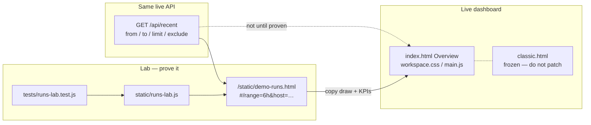

# Lab, then patch

New Overview widgets land on an isolated demo page first. The live
workspace (`index.html` + `workspace.css`) and frozen Classic stay
untouched until the lab chart matches real `/api` data and the hash
filters already used on Overview.

## Flow

## Why lab first

Overview charts measure their containers after workspace switches.
Patching `index.html` while the grain, host filter, or hover tips are
still moving risks a zero-size render or a hash fight with
`filters.js`. The lab page reuses the same `#/range=` / `&host=` tokens
and the same `exclude=pool_status,host_stats` history fetch, without
touching the workspace layout.

## Patch checklist (when a lab page is proven)

1. Helpers already covered by `node --test` stay the source of truth.
2. Copy the proven draw into Overview; keep Classic frozen.
3. Wire the existing range/host chips — do not add a second hash parser.
4. Confirm `#/range=6h` on Overview matches the lab KPIs for the same window.

## Current lab

| Version | Open | Lands on after patch |
|---|---|---|
| **runs-v1** | `/static/demo-runs.html#/range=6h` | Overview request volume vs errors |
| **context-v1** | `/static/demo-context.html#/range=6h` | Memory & KV context growth |
| **memory-v1** | `/static/demo-memory.html#/range=6h` | Memory & KV pool + efficiency |
| **speed-v1** | `/static/demo-speed.html#/range=6h` | Overview tok/s · duration · output tokens (IQR bands, lanes, heatmap) |
| **fan-v1** | `/static/demo-fan.html#/range=6h` | Live ops MoA radial (waterfall stays) |
| **router-v1** | `/static/demo-router.html#/range=6h` | Routing & roles traffic split + role usage |
